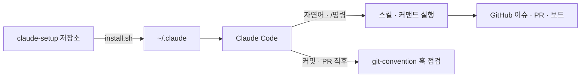

# claude-setup

> Claude Code를 내 작업 방식대로 움직이게 만드는 스킬·커맨드·훅 설정 모음

현재 [v0.5.0](./CHANGELOG.md)

## 주요 기능

- **같은 환경 어디서나**: 설치 한 번으로 여러 컴퓨터의 Claude Code 설정 통일
- **이슈 기반 작업**: 이슈 등록 → 작업 공간 분리 → 작업 전후 캡처 → PR 까지 순서대로 진행
- **읽기 쉬운 커밋·PR·릴리스 노트**: 누구나 읽는 제목과 나중에 추적 가능한 본문, 형식 자동 점검
- **새 프로젝트 초기 세팅**: GitHub 작업 보드·라벨·기본 문서·작업 규칙을 한 번에 구성
- **문서 정리**: 프로젝트 문서를 분류하고 AI가 찾기 쉬운 목차(INDEX) 자동 생성
- **기획서 기반 개발 문서**: 기획서 하나로 요구사항·기능명세·API 명세 등 10종 생성
- **발표자료·Obsidian 정리**: 승인한 기획안으로 같은 디자인의 PPT 생성, 노트 형식 통일·분류

## 핵심 개념

| 용어 | 의미 |
|---|---|
| 스킬 | 자연어나 `/이름` 으로 부르는 여러 단계 자동화 절차. `skills/<이름>/SKILL.md` |
| 커맨드 | `/이름` 으로 부르는 단일 명령. `commands/` |
| 훅 | Claude 가 커밋·PR 을 만든 직후 자동으로 도는 형식 점검. `hooks/` |
| 이슈 = 워크트리 = PR | 작업 하나마다 이슈·작업 폴더·PR 을 하나씩 짝지어 진행 |
| 원본은 이 저장소 | `~/.claude` 는 설치본. 수정은 여기서 하고 push → 각 컴퓨터에서 다시 설치 |

## 동작 방식



## 프로젝트 구조

```text
claude-setup/
├── skills/          자동화 스킬
│   ├── issue-*      이슈 → 워크트리 → 증거 → PR
│   ├── git-*        커밋·PR·릴리스·보드
│   ├── repo-init    새 프로젝트 세팅
│   ├── docs-tidy    문서 정리·INDEX
│   ├── ai-switch    AI 구독 계정 전환
│   └── deck         발표자료
├── commands/        슬래시 명령
│   ├── project/     docs 협업
│   └── obsidian/    볼트 관리
├── hooks/           커밋·PR 형식 점검
├── docs/            guide(사용법) · spec(목록·규약)
├── install.sh       설치 스크립트
├── INDEX.md         AI 문서 색인
└── CLAUDE.md        AI 작업 규칙
```

## 시작하기

```bash
git clone https://github.com/gyeolhwi/claude-setup.git && cd claude-setup
./install.sh --check     # 필요한 프로그램 점검
./install.sh             # ~/.claude 에 설치
```

업데이트: `git pull` 후 `./install.sh --copy --no-obsidian`

## 문서 안내

- [설치와 세팅](./docs/guide/install.md): 설치 옵션·설치 위치·동기화 방법
- [이슈 워크플로우](./docs/guide/issue-workflow.md): 이슈 등록부터 통합까지 사용법
- [Git 워크플로우](./docs/guide/git-workflow.md): 커밋·PR·릴리스 규칙
- [커맨드·스킬 카탈로그](./docs/spec/catalog.md): 전체 명령 목록과 호출 방법
- [INDEX.md](./INDEX.md): 전체 문서 색인. AI 는 여기부터 읽고 맞는 문서만 선택
