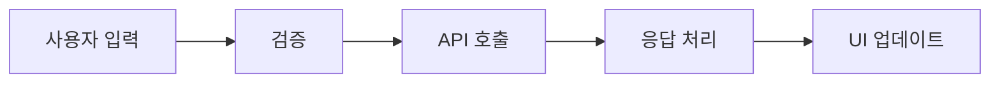
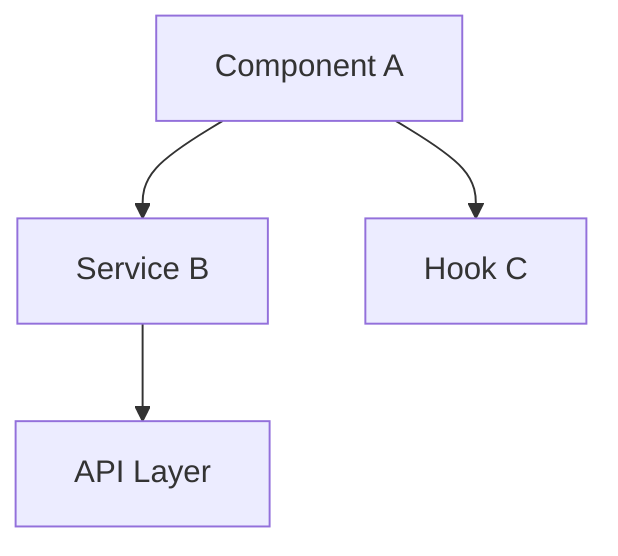
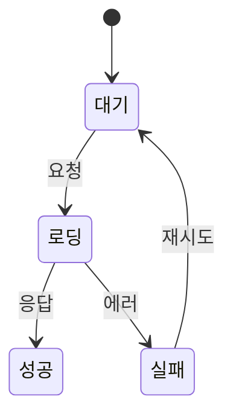

# git-pr — PR 규칙과 생성

짝 스킬: `git-commit`(커밋 규칙) · `git-release`(배포 릴리스 노트). 세 스킬은 같은 TYPE·scope 규칙을 쓴다.
PR 의 `달라지는 점` 섹션은 나중에 `git-release` 가 릴리스 노트 항목으로 그대로 가져간다.

## 핵심 규칙

### 절대 금지 사항
- **`🤖 Generated with Claude Code` 또는 `Co-Authored-By: Claude` 등 AI 생성 표시 문구를 PR 본문, 제목, 커밋 메시지 어디에도 절대 포함하지 않는다.**
- 이 규칙은 어떤 상황에서도 예외 없이 적용된다.

### 언어 규칙
- PR 제목과 본문은 **한국어**로 작성한다.
- 코드 블록, 파일 경로, 기술 용어는 영문 그대로 사용한다.

## PR 생성 절차

### 1단계: 상태 파악

다음 명령어를 **병렬로** 실행하여 현재 브랜치 상태를 파악한다:

```bash
# 1. 작업 트리 상태
git status

# 2. 스테이징/언스테이징 변경사항
git diff --staged && git diff

# 3. 리모트 트래킹 상태
git rev-parse --abbrev-ref --symbolic-full-name @{u} 2>/dev/null

# 4. 베이스 브랜치와의 차이 (커밋 히스토리 + diff)
git log <base-branch>...HEAD --oneline
git diff <base-branch>...HEAD --stat
```

### 2단계: 베이스 브랜치 결정

- 사용자가 베이스 브랜치를 지정한 경우 → 해당 브랜치 사용
- 지정하지 않은 경우 → 저장소 기본 브랜치 (`gh repo view --json defaultBranchRef -q .defaultBranchRef.name`, 실패하면 `main`)

### 3단계: 변경사항 분석

**모든 커밋을 분석한다** — 최신 커밋만이 아니라, 베이스 브랜치에서 분기한 이후의 **전체 커밋**을 검토한다.

분석 항목:
- 변경된 파일 목록과 각 파일의 변경 유형 (신규/수정/삭제)
- 변경의 성격 (기능 추가, 버그 수정, 리팩토링, 설정 변경 등)
- 주요 로직 변경 포인트
- 영향 범위

### 4단계: PR 작성 및 생성

#### 읽는 사람

PR은 **PM, 리뷰어, AI**가 모두 읽는다. 본문은 위에서 아래로 갈수록 기술적으로 쓴다.

| 구역 | 읽는 사람 | 쓰는 말 |
|---|---|---|
| 제목, `요약`, `달라지는 점` | PM | 기술 용어 없이 결과 중심 |
| `왜`, `구현`, `리뷰 포인트`, `확인 방법`, `영향 범위` | 리뷰어 | 구체적으로, 코드 이름 그대로 |
| `관련` | AI | 이슈·커밋을 고정 형식으로 연결 |

#### PR 제목 규칙

커밋 제목 규칙(`git-commit` 스킬)과 같다. 날짜만 붙이지 않는다 (PR에 생성일이 이미 있음).

- 형식: `<TYPE>(<scope>): <subject>`
- TYPE: `FEAT` `UX` `FIX` `PERF` `CONTENT` `DOCS` `REFACTOR` `TEST` `CHORE` `REVERT`
  - 커밋이 여러 TYPE에 걸치면 사용자에게 가장 크게 체감되는 것을 고른다 (FEAT > FIX > UX > PERF > CONTENT > 나머지)
- scope: 무엇에 대한 변경인지 바로 알 수 있는 영문 소문자 단어 (`team`, `signup`, `payment`, `infra`, `config`, `docs`)
- subject: 한국어 40자 안팎. **어떻게 했는지가 아니라 무엇이 달라지는지**. 기술 용어 금지. FIX는 `~하던 문제 해결`, 사용자 변화가 없으면 끝에 `(사용 변화 없음)`

예: `FIX(team): 팀 채널에서 팀짜기가 막히던 문제 해결`

#### PR 본문 템플릿

모든 섹션 제목은 항상 같은 이름·순서로 쓴다 (AI가 섹션 단위로 찾아 읽는다). 해당 없는 선택 섹션은 통째로 지운다. 빈 섹션이나 `<!-- -->` 주석을 남기지 않는다.

```markdown
## 요약
<PM용 1~2문장. 이 PR이 머지되면 누가 무엇을 다르게 겪는지>

## 달라지는 점
- <사용자·운영자가 체감하는 변화. 없으면 "사용 변화 없음">

## 왜
<배경 또는 원인 1~3줄. FIX면 증상과 원인>

## 구현
- `<파일·모듈>`: `<함수·설정 이름>` <무엇을>

## 리뷰 포인트
- <리뷰어가 특히 봐야 할 곳과 이유. 고민한 대안, 의도적으로 하지 않은 것>

## 확인 방법
- [x] <실제로 실행한 명령·확인과 결과>
- [ ] <리뷰어가 직접 확인할 것>

## 영향 범위 (선택)
- <함께 영향받는 기능, 마이그레이션·환경변수·배포 순서 등 주의사항>

## 화면 (선택: UX·FEAT·화면이 바뀐 FIX)
| 전 | 후 |
|---|---|
| <이미지> | <이미지> |

## 관련
- 이슈: #<번호> <이슈 제목>
- 커밋: <짧은 해시> <커밋 제목> (PR의 커밋 목록 그대로)
- 연관: <원인 커밋·선행 PR 등 확인된 것만>
```

작성 규칙:
- `요약`과 `달라지는 점`은 PM이 이 두 섹션만 읽고 판단할 수 있게 쓴다.
- `구현`의 이름은 코드에 있는 그대로 쓴다. 파일 전체 목록은 쓰지 않는다 (Files changed 탭에 있음).
- `확인 방법`의 `[x]`는 실제로 실행한 것만 체크한다. 실행하지 않은 것을 체크하지 않는다.
- `관련`의 이슈 연결은 `#번호`만 쓴다. `Closes`·`Fixes`·`Resolves`는 사용자가 요청하거나 저장소 관행이 그럴 때만 쓴다 (issue-merge 흐름을 쓰는 저장소에서는 금지).
- 이슈·연관 커밋은 확인된 것만 쓰고 추측하지 않는다.

#### 예시

```markdown
## 요약
팀 채널에서도 바로 팀짜기를 할 수 있게 됩니다. 운영자가 로비 채널로 옮겨갈 필요가 없습니다.

## 달라지는 점
- 팀 채널에서 /팀짜기가 동작함
- 같은 채널에서 다시 팀을 짜면 이전 판이 자동으로 끝남

## 왜
팀 채널 타입이 허용 채널 목록에 없어 권한 검사에서 막히고 있었습니다.

## 구현
- `team/channels.ts`: `ALLOWED_CHANNELS`에 `TEAM` 타입 추가
- `team/session.ts`: 재분배 시 `endActiveSession()`으로 같은 채널의 진행 중 세션 종료

## 리뷰 포인트
- `endActiveSession()`이 다른 채널 세션은 건드리지 않는지 (channelId 조건)
- 세션을 강제 종료하는 대신 경고만 띄우는 안도 있었으나, 운영자 요청에 따라 자동 종료로 결정

## 확인 방법
- [x] `pnpm test team` 통과 (12/12)
- [x] 테스트 서버 팀 채널에서 /팀짜기 2회 실행, 이전 판 종료 확인
- [ ] 로비 채널 동작이 그대로인지

## 관련
- 이슈: #32 팀 채널에서 팀짜기 권한 오류
- 커밋: c84e210 FIX(team): 팀 채널에서 팀짜기가 막히던 문제 해결 - 2026-11-10
```

### Mermaid 다이어그램 활용 가이드

다음과 같은 경우 mermaid 다이어그램을 **구현** 섹션 아래에 포함한다:

**1. 데이터/처리 흐름이 변경된 경우:**

````markdown

````

**2. 컴포넌트/모듈 간 관계가 변경된 경우:**

````markdown

````

**3. 상태 변경 흐름이 있는 경우:**

````markdown

````

**다이어그램이 불필요한 경우:**
- 단순 버그 수정 (한두 줄 변경)
- 텍스트/스타일만 변경
- 설정값 변경
- 변경 범위가 단일 파일로 한정

### 5단계: 실행

```bash
# 필요 시 리모트 푸시
git push -u origin <branch-name>

# PR 생성
# 본문은 UTF-8 파일로 저장한 뒤 넘긴다
gh pr create --base <base-branch> --title "<제목>" --body-file <본문 파일>
```

생성 완료 후 PR URL을 사용자에게 반환한다.

## 자동 점검 훅

`~/.claude/hooks/git-convention.py` 가 Claude 가 실행한 `gh pr create`·`gh pr edit` 직후 제목 형식과 본문 필수 섹션(`요약`, `달라지는 점`, `관련`)을 검사한다. 어긋나면 `gh pr edit <번호> --title ... --body-file ...` 로 고친다.

## 주의사항

- 커밋되지 않은 변경사항이 있으면 먼저 사용자에게 알린다
- `--force` 푸시는 절대 하지 않는다
- PR 생성 전 리모트 브랜치가 최신인지 확인한다
- 민감한 파일(.env, credentials 등)이 포함되어 있으면 경고한다
